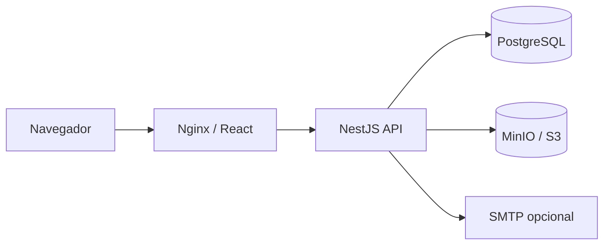

# 🛍️ E-Commerce Full Stack Platform


Una plataforma de comercio electrónico completa, escalable y didáctica diseñada para una tienda de ropa. Este proyecto está construido desde cero aplicando principios de Arquitectura de Software, Domain-Driven Design (DDD) ligero y buenas prácticas de DevOps.

## 🎯 Objetivo del Proyecto

Este sistema nace con un doble propósito:
1. **Solución Real:** Digitalizar y automatizar el flujo de ventas para un negocio familiar (tienda de ropa).
2. **Portafolio Laboral & Aprendizaje:** Consolidar habilidades como Ingeniero Full Stack, sirviendo como una muestra sólida y documentada para aplicar a roles técnicos (CV/LinkedIn).

---

## 🛠️ Stack Tecnológico Principal (End-to-End TS/JS)

**Frontend:**  


**Backend & Datos:**  


**Infraestructura & DevOps:**  


**Otras Tecnologías:**
* **Storage:** S3 compatible (MinIO en Docker; AWS S3 o R2 en la nube)
* **Pruebas:** Jest (API) + Playwright (tienda)
* **Proxy/Servidor:** Docker Compose + Nginx
* **Correo:** SMTP opcional (si no hay servidor, queda en logs)



---

## 🚀 Puesta en Marcha

### Opción A — Todo con Docker (recomendada)

```bash
cp .env.example .env          # define JWT_SECRET antes de continuar
docker compose up -d --build
```

Servicios disponibles:

| Servicio | URL |
|---|---|
| Tienda (React) | http://localhost:5173 |
| API (NestJS) | http://localhost:3000/api/v1 |
| Swagger | http://localhost:3000/api/docs |
| pgAdmin | http://localhost:5050 |
| MinIO (S3) | http://localhost:9000 — consola http://localhost:9001 |
| PostgreSQL | `localhost:5433` |

Las migraciones se aplican solas al arrancar el contenedor de la API. Para cargar
categorías y el usuario administrador:

```bash
cd e-commerce-backend && npm run db:seed
```

### Opción B — Desarrollo local

```bash
docker compose up -d postgres          # solo la base de datos

cd e-commerce-backend
cp .env.example .env
npm install && npm run db:migrate && npm run db:seed
npm run start:dev

cd ../e-commerce-frontend
cp .env.example .env
npm install && npm run dev
```

> El contenedor de PostgreSQL publica el puerto **5433** para no chocar con una
> instalación nativa de PostgreSQL que ocupe el 5432.

### Credenciales de desarrollo

Las genera `npm run db:seed` y se configuran con `SEED_ADMIN_EMAIL` / `SEED_ADMIN_PASSWORD`:

```
admin@tienda.com     /  Admin123!
cliente@tienda.com   /  Cliente123!
```

### Pago por transferencia

El checkout solo acepta **transferencia bancaria**. El cliente transfiere el total, sube una captura del comprobante (JPG/PNG/WEBP, máx. 5 MB) y el pedido se crea en estado **Pagada**. El admin ve el comprobante en `/admin/orders`.

Puedes armar el carrito **sin cuenta**; al iniciar sesión se fusiona con el carrito del servidor. El pago sí requiere login.

Configura la cuenta en `e-commerce-backend/.env` (y en el `.env` de la raíz si usas Docker):

```
TRANSFER_BANK_NAME=Banco Pichincha
TRANSFER_ACCOUNT_TYPE=Ahorros
TRANSFER_ACCOUNT=2100123456
TRANSFER_HOLDER=Tienda de Ropa
TRANSFER_ID=
TRANSFER_CURRENCY=USD
```

### Scripts útiles del backend

| Comando | Descripción |
|---|---|
| `npm run db:migrate` | Crea y aplica una migración en desarrollo |
| `npm run db:deploy` | Aplica migraciones pendientes (producción) |
| `npm run db:seed` | Carga categorías, admin y datos de ejemplo |
| `npm run db:reset` | Borra la base de datos y reaplica todo |

> Usa siempre estos scripts en lugar de `npx prisma ...`: `npx` descargaría el CLI
> 8.x de Prisma Platform, que no incluye el comando `migrate` del ORM.

---

## 🚢 Producción (VPS o demo de portafolio)

Detalle operativo: [`docs/05-devops/docker-ci-cd.md`](docs/05-devops/docker-ci-cd.md).

```bash
docker compose -f docker-compose.yml -f docker-compose.prod.yml up -d --build
```

Eso apaga Swagger, marca `NODE_ENV=production` y deja pgAdmin fuera (perfil `tools`). Pon un proxy TLS delante de `localhost:5173` (nginx del contenedor `web`).

Variables críticas: `JWT_SECRET`, `CORS_ORIGIN`, `FRONTEND_URL`, `TRANSFER_*`, `STORAGE_DRIVER`/`S3_*`, y si quieres avisos reales `SMTP_*`.

Health: `GET http://localhost:3000/api/v1/health` y `/api/v1/health/ready`.

### Playwright

Desde `e-commerce-frontend`, con la API arriba y un `npm run build`:

```bash
npx playwright install chromium
npm run test:e2e
```

---

## 🏗️ Enfoque de Ingeniería (Roles Asumidos)

Para garantizar la calidad empresarial del proyecto, el desarrollo se rige bajo las siguientes perspectivas:
* 📐 **Arquitecto de Software:** Diseño de la estructura técnica, capas, patrones y gestión de dependencias.
* 📋 **Analista de Requerimientos:** Definición de historias de usuario, casos de uso y criterios de aceptación.
* 🚀 **Líder Técnico:** Implementación guiada por fases (8-10 semanas), aplicación de buenas prácticas y DevOps.
* 📚 **Asistente Académico:** Documentación de decisiones de diseño, diagramas SQL y entregables formales.

---

## 📦 Estructura de Módulos

El sistema está compuesto por los siguientes módulos Core funcionales:
- [x] Catálogo y Gestión de Variantes
- [x] Carrito de Compras y Checkout (invitado + sesión)
- [x] Gestión de Pedidos y Devoluciones
- [x] Clientes y Autenticación
- [x] Inventario y Compras
- [x] Administración y Reportes
- [x] Usuarios y Control de Roles (RBAC: Admin, Vendedor, Cliente)
- [x] Soporte y Notas Internas

---

## ⚙️ Requerimientos No Funcionales

* 🛡️ **Seguridad:** Hashing de contraseñas (Bcrypt), JWT (Access + Refresh tokens), Rate-Limiting, y protección CORS/CSRF.
* ⚡ **Desempeño:** Tiempo de carga del catálogo menor a 2 segundos (< 2s).
* 🧱 **Estabilidad:** Arquitectura modular basada en capas de servicios.
* 📱 **Accesibilidad:** Estándar AA, diseño 100% Mobile-First y Responsive.
* 🧪 **Calidad:** Pruebas automatizadas (Unitarias y E2E).
* 📈 **Operaciones:** Monitoreo activo y política de backups.

---

## 📋 Entregables del Proyecto

El ciclo de vida de este desarrollo contempla la entrega de los siguientes artefactos:

1. Resumen ejecutivo, actores, metas y alcance.
2. Historias de usuario + criterios de aceptación (formato Gherkin).
3. Especificación de requerimientos funcionales y no funcionales.
4. Modelo de datos (ER, diccionario de datos y DDL SQL).
5. Arquitectura por capas (diagramas y patrones aplicados).
6. Documentación API REST (OpenAPI / Swagger / Postman).
7. Frontend: Wireframes, flujos de pantallas y estados.
8. Políticas de seguridad y cumplimiento.
9. Reporte de pruebas automatizadas.
10. DevOps y Despliegue (Archivos `docker-compose.yml`, pipelines CI/CD).
11. Observabilidad (Logs, métricas, health checks).
12. Matriz de riesgos y mitigaciones.
13. Cronograma de trabajo (8 - 10 semanas) y *Definition of Done*.
14. Plan de evolución futura (Multitienda, Marketplace, Motor de recomendaciones).

---

## 💻 Herramientas de Desarrollo Recomendadas

* **IDE:** VS Code / Cursor
* **Diseño UI/UX:** Figma
* **Base de Datos:** Prisma Studio
* **Testing de APIs:** Postman
* **Documentación:** Markdown
* **CI/CD:** GitHub Actions
* **Monitoreo:** Uptime Kuma
* **Pruebas de Carga:** k6

---

## 🎓 Valor Académico y Profesional

Este repositorio sirve como evidencia comprobable de:
* Redacción de documentación formal, trazable y reproducible.
* Escritura de código limpio, mantenible y modular (DDD ligero).
* Orquestación de infraestructura local y en la nube mediante Docker Compose.
* Aplicación estricta de buenas prácticas en seguridad, logs, pruebas automatizadas y pipelines de CI/CD.